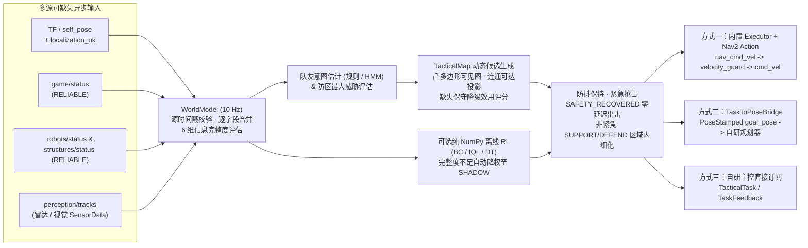
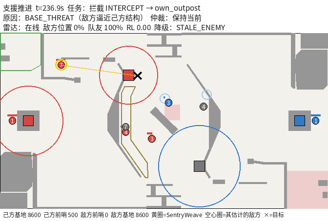
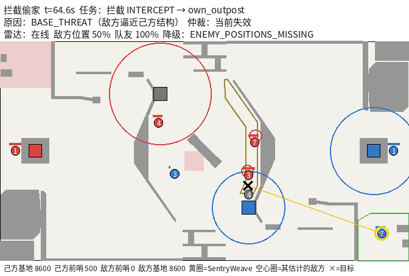
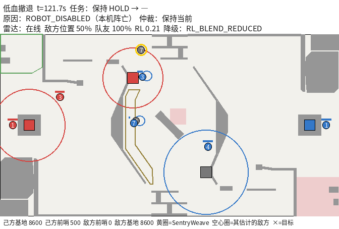
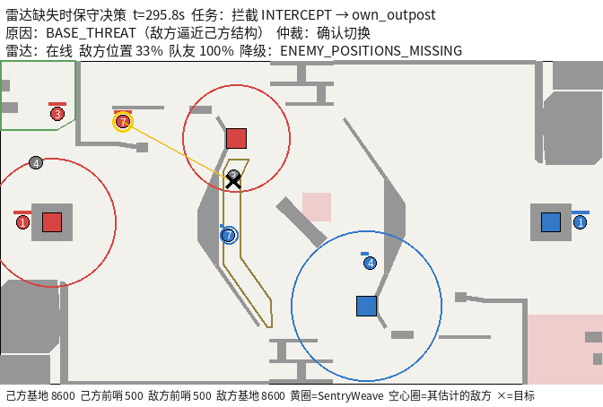
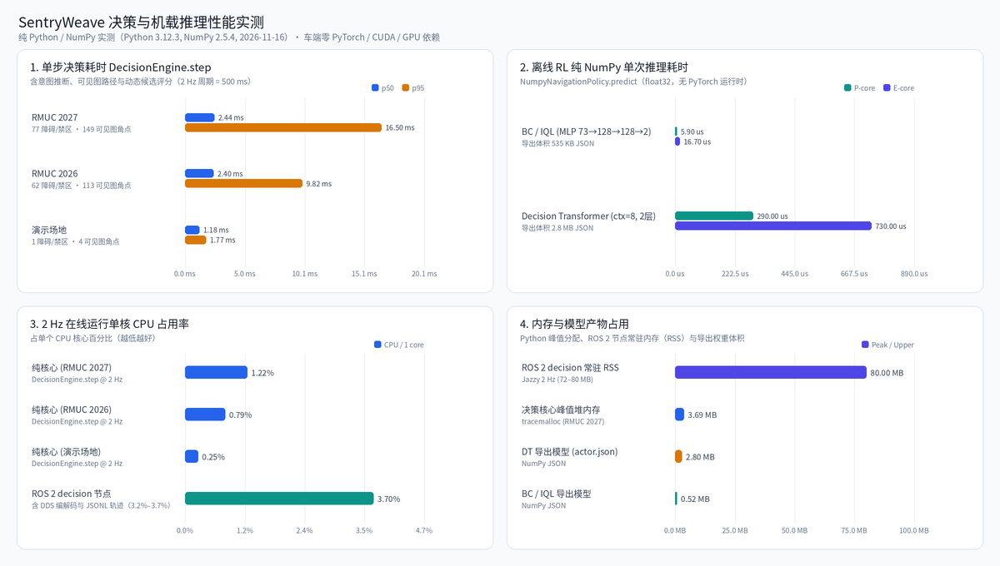

<p align="center">
  
</p>

# SentryWeave

[](https://github.com/yelle233/SentryWeave/actions/workflows/ci.yml)
[](https://docs.ros.org/en/jazzy/)
[](https://www.python.org/)
[](LICENSE)

**Open-interface, radar-dropout-resilient cooperative sentry decision making and pure-NumPy onboard offline RL for RoboMaster (ROS 2 Jazzy & pure Python).**

SentryWeave 是面向 RoboMaster 哨兵的**开放输入输出接口、雷达信息缺失鲁棒协同决策与纯 NumPy 机载离线强化学习框架**。系统对多源异步输入做源时间戳与逐字段有效位融合，在雷达掉线或裁判字段残缺时平滑保守降级；结合可解释规则效用、可选 HMM 队友意图估计与基于公开赛事日志训练的 **BC / IQL / Decision Transformer** 模型，输出带租约的合法战术目标，并可与任意 ROS 2 Nav2 栈、`PoseStamped` 自研规划器或纯 Python 主控解耦对接。

| 项目信息 | 内容 |
|---|---|
| 项目名称 | SentryWeave |
| 战队 | **未来战队** |
| 维护者 | [yelle233](https://github.com/yelle233) |
| 联系邮箱 | [1376982098@qq.com](mailto:1376982098@qq.com) |

---

## 决策需要什么输入、给出什么输出

SentryWeave 不绑定特定战队串口帧或雷达私有协议，外部驱动只需映射到标准化的强类型接口（未获知的字段置 `*_valid = false`）。完整逐字段契约、有效位差异与桥接代码见 [开放输入输出接口规范](docs/interfaces.md)。

### 输入总表（默认命名空间 `/sentry`，均可重映射）

| 输入通道 / 配置 | 类型与建议频率 | `world_model` 订阅 QoS | 可否缺失与缺失时的决策行为 |
|---|---|---|---|
| `game/status` | `sentry_interfaces/GameStatus`<br>1–5 Hz | **`RELIABLE`**, Volatile, KeepLast(1) | **比赛阶段不可缺失**：`phase` 未知或超时（`> 2.0 s`）立即输出紧急 `HOLD (GAME_STATE_UNKNOWN)`；非比赛期输出 `HOLD (GAME_NOT_RUNNING)`；`own_team` 与配置冲突输出 `HOLD (TEAM_MISMATCH)`。`supply_available` 可缺失（未知或 `false` 时仅停生 `RECOVER`） |
| `robots/status` | `sentry_interfaces/RobotStatusArray`<br>1–10 Hz | **`RELIABLE`**, Volatile, KeepLast(10) | **可部分或全部缺失**（支持裁判串口、雷达站、队内链路并发按字段合并；`hp_valid` 与 `max_hp_valid` 独立；`team` 恒为相对本车的 `ALLY=1 / ENEMY=2`）：未知作 `None`（绝不当 0 或满值）；敌方血量未知关闭残血选敌加分，本机血量/发弹比例未知禁止激进 `SUPPORT` 但保留 `DEFEND` / `INTERCEPT` |
| `structures/status` | `sentry_interfaces/StructureStatus`<br>1–5 Hz | **`RELIABLE`**, Volatile, KeepLast(10) | **可缺失**（注意单个 `hp_valid` 同时覆盖 `hp` 与 `max_hp`）：双方基地/前哨状态未知时视为“存活但未确认”，前哨进攻战略价值乘 `0.7`；确认敌方前哨被毁立即剔除，确认己方前哨被毁抬高 `DEFEND` 战略价值 `+0.12` |
| `perception/tracks` | `sentry_interfaces/ObservationArray`<br>5–20 Hz | `SensorDataQoS`（**`BEST_EFFORT`**, KeepLast(5)） | **可随时突发断流或丢包**（本机 `ALLY + self_id` 自动忽略，非 `map` 帧按采集时刻查 TF）：`0.9..5.0 s` 陈旧敌方轨迹线性衰减置信度，按敌方视野缺失率自动抬高核心防区紧迫度（最高 `+0.25`），按队友视野完整度缩放 `SUPPORT` 协同项，完整度 `< 0.6` 时按比例下调直至关闭 RL 权重 |
| `map -> odom -> base_link`（或 `self_pose`）+ `localization_ok` | TF / `PoseWithCovarianceStamped`（10–50 Hz）<br>`std_msgs/Bool`（5–20 Hz） | TF 标准 / `SensorDataQoS`<br>`localization_ok`：**`RELIABLE`**, KeepLast(1) | **不可缺失**：本机权威定位直接使用定位输出而不做二次平滑，贴墙落入膨胀边缘时由 `arena.origin(pos)` 吸附起点防自锁；超时 `> 0.5 s` 或 `localization_ok=false` 立即进入 `SAFE_STOP`（`HOLD: LOCALIZATION_INVALID`） |
| 赛季战术与场地配置 | [`tactics_rmuc2027.yaml`](src/sentry_bringup/config/tactics_rmuc2027.yaml) + [`field_rmuc2027.yaml`](src/sentry_bringup/config/field_rmuc2027.yaml) | 启动加载静态文件 | 只声明障碍/规则禁区、建筑、补给区、战术区域与偏好点语义，不锁死移动范围；默认 `mirror: auto` 在 `own_team=BLUE` 时绕场地中心 180° 自动换算并推导 `self_id`（`RED -> 7`、`BLUE -> 107`） |
| `referee/state` | `sentry_interfaces/RefereeState`<br>1–5 Hz | **`RELIABLE`**, Volatile, KeepLast(1) | **旧版兼容接口（将废弃，可选）**：同一语义字段只要上方新强类型接口有效且未超时，一律以新接口为准 |

> **DDS QoS 兼容性提示**：`game/status`、`robots/status`、`structures/status`、`localization_ok`（及 `referee/state`）订阅端均为 `RELIABLE`。编写上游桥接节点时发布端必须同样使用 `RELIABLE`，若误用 `BEST_EFFORT` 将因 QoS 不兼容被 DDS 静默丢弃。

### 输出总表

| 输出通道 / 动作 | 类型与默认频率 | QoS / 开关 | 语义与下游消费契约 |
|---|---|---|---|
| `tactical/task` | `sentry_interfaces/TacticalTask`<br>2 Hz（临界跳变即发） | **`RELIABLE`**, Volatile, KeepLast(1) | 带 `(session_id, task_id)` 与租约截止时刻 `valid_until`（默认 `2.0 s`）的战术指令：`HOLD / SUPPORT / INTERCEPT / DEFEND / RECOVER`、严格满足 `arena.legal(goal)` 的 `map` 系目标位姿 `target_pose`、`urgent` 抢占位与 `reason_code`。下游可通过 `tactical/feedback` 回传 `FAILED / REJECTED / CANCELED / SUCCEEDED` 驱动 `5.0 s` 失败点冷却 |
| `world/state` | `sentry_interfaces/WorldState`<br>10 Hz | **`RELIABLE`**, Volatile, KeepLast(1) | 多源融合世界快照与运行模式（`FULL / PARTIAL / LOCAL_ONLY / SAFE_STOP`） |
| `team/intents` | `sentry_interfaces/TeammateIntentArray`<br>2 Hz | **`RELIABLE`**, Volatile, KeepLast(1) | 在场队友 6 类战术意图（进攻前哨、守家、控区、撤退、机动、未知）概率分布与置信度 |
| `threat/state` | `sentry_interfaces/ThreatState`<br>2 Hz | **`RELIABLE`**, Volatile, KeepLast(1) | 各 `DEFEND_BASE` 防区的最大威胁分 `score`（恒取防区内单机威胁最大值，残血奖励仅影响优先锁定的 `enemy_id` 与 `eta_sec`） |
| `tactical/trace` | `std_msgs/String` / 滚动 JSONL<br>2 Hz | **`RELIABLE`**, Volatile, KeepLast(1) | 单行 JSON 决策全量审计流，记录 `missing_info`（6 维完整度、缺失项、生效降级动作）、`policy_info`（RL 提议、有效混合比、子目标细化状态、模型指纹回退 `model_fallbacks`）与单步耗时 `decision_ms` |
| `compute_path_to_pose` / `navigate_to_pose` | Nav2 Action | 默认开启（`enable_executor:=true`） | 内置 `executor` 独占管理整条路径规则合法性预检（可用 `check_path_before_navigate:=false` 关闭）、目标下发、取消与终态确认 |
| `motion/permit` & `cmd_vel` | `MotionPermit`（20 Hz）<br>`geometry_msgs/Twist`（50 Hz） | 默认开启（`enable_velocity_guard:=true`） | 单调时钟双看门狗：接收导航栈输出的 `nav_cmd_vel`（`0.25 s` 超时）与执行器运动许可（`0.3 s` 超时），限幅门控后输出最终底盘速度 `cmd_vel` |

### 不经过 ROS 2 的纯 Python 进程内调用

核心包 `sentry_core` 零 ROS 依赖（仅依赖 `numpy` 与 `PyYAML`），自研 Python 主控或自定义仿真器可直接构造 `WorldModel` 并调用 `DecisionEngine.step(world)`：

```python
from sentry_core.config import load_config
from sentry_core.policy import DecisionEngine
from sentry_core.tracking import WorldModel

cfg = load_config("src/sentry_bringup/config/tactics_rmuc2027.yaml", own_team="RED")
world_model, engine = WorldModel(cfg), DecisionEngine(cfg)
decision = engine.step(world_model.snapshot(now=10.0))
```

完整输入注入示例见 [开放输入输出接口规范 §5.1](docs/interfaces.md#51-示例-a不依赖-ros-2-的纯-python-调用sentry_core)，三种下游导航接线方式（Nav2 Action、`PoseStamped` 话题桥接、直接消费 `TacticalTask`）见 [接入自有导航栈指南](docs/navigation-integration.md)。

---

## 系统架构与缺失鲁棒设计



- **统一“未知”与单调保守降级**：过期或 `*_valid=false` 的字段统一表示为 `None`，既不当作 `0` 血阵亡，也不当作满血安全；已确认阵亡（`known_alive == False`）的机器人自动从期望在场人数分母中扣除，避免将对手减员误判为雷达掉线。当雷达突发中断时，最近 `0.9..5.0 s` 内的敌方最后已知位置按线性衰减权重继续参与威胁计算，基地防区驻防紧迫度按 `0.25 * (1 - completeness["enemies"])` 自动抬升，队友失联时按 `0.5 + 0.5 * completeness["allies"]` 收敛孤军前压倾向。安全原因触发的 `HOLD`（如开赛前 `READY` 或短时定位抖动）在恢复正常的首个周期跳过防抖窗口立即切换最优任务（`SAFETY_RECOVERED`）。
- **离线 RL“只细化不越权”合同与影子模式**：
  1. **路线混合**：`GoalPrior` 先在相同推进步长上对可行规则候选计算方向一致性得分，按 `effective_blend` 混合效用；
  2. **只细化不篡改**：经防抖仲裁选出胜出规则任务后，投影到合法可达空间的 RL 子目标**仅允许微调非紧急 `SUPPORT` / `DEFEND` 任务的目标坐标**（必须落在该任务所属区域内或距原规则点 `<= 1.5 m`、连通可达且满足友军安全间距），**绝不改变胜出任务的类型、区域、关联机器人或紧急属性**；一旦细化坐标导航失败，仅将 `rl_subgoal` 冷却 `5.0 s` 并立即恢复原规则目标点；
  3. **视野残缺自动退坡与影子采集**：当 `allies` 或 `enemies` 位置完整度低于 `0.6` 时，`effective_blend` 自动按比例下调直至 `0`（退回纯规则）；设置 `rl_blend:=0.0` 即启用**影子模式（`SHADOW`）**——实车运动 100% 由规则策略控制，同时在 `tactical/trace` 中完整记录每帧模型提议供赛后 `sentry-rl replay` 复盘。

---

## 仿真多局面行为演示（Arena-1 RMUC 2027）

以下四段俯视轨迹动画录制自 RMUC 2027（28×15 m，5v5）完整对抗回放，展示哨兵在不同战场态势与雷达丢包条件下的在线任务切换与原因码审计：

| 支援推进（`SUPPORT · TEAM_SUPPORT_HIGH`） | 拦截偷家（`INTERCEPT · BASE_THREAT`） |
|---|---|
| <br><sub>变体 `rl_r0`（红方 7 号，雷达丢包 0%）：队友向敌方前哨协同推进时，哨兵生成侧后支援点并在区域内受控细化站位。</sub> | <br><sub>变体 `rule_r30`（蓝方 107 号，`mirror: auto` 自动中心对称镜像，雷达突发丢包 30%）：敌方突入基地防区达到紧急阈值，立即抢占回防拦截。</sub> |
| **低血撤退（`RECOVER · LOW_RESOURCES`）** | **雷达缺失时保守决策（`DEFEND · AREA_UNCOVERED`）** |
| <br><sub>变体 `rl_r0`（红方 7 号）：交火后自身血量跌破阈值触发强制恢复锁存，跳过普通防抖返回己方补给区直至回血脱离退出阈值。</sub> | <br><sub>变体 `rule_r60`（红方 7 号，雷达突发丢包 60%）：外部敌我位置成片中断期间，自动抬高核心防区紧迫度收缩稳守关键通道。</sub> |

> **画面图例**：黄圈标注的己方圆点 = SentryWeave 控制的哨兵（红方 `7` 号 / 蓝方 `107` 号）；实心圆 = 场地实时存活机器人；空心圆 = 哨兵内部 `WorldModel` 当前跟踪/衰减保留的敌方轨迹；`×` 与虚线 = 当前下发的合法目标点；顶栏实时叠加当前 `TaskType`、`reason_code`、仲裁结果与雷达视野完整度。

### 雷达随机成片丢失（`0% / 30% / 60% / 100%`）闭环行为摘要

固定 10 个随机种子（`42..51`）× 红蓝换边（每变体 `20` 局，含对照组共 `180/180` 局完赛，单局 `420 s`，平均持续 `3.0 s` 的成片雷达中断 + `0.15 m` 噪声 + `0.2 s` 延迟；完整数据表含 `reference` 对照见 [实验基线](docs/benchmarks.md)）：

| 变体 | 完赛局数 | 雷达在线率 | 敌 / 友位置完整度 | 存活率 | 造成伤害 | `HOLD` | `INTERCEPT` | `DEFEND` | `RECOVER` | RL 参与率 | 策略异常 / 超时 |
|---|---:|---:|---:|---:|---:|---:|---:|---:|---:|---:|---:|
| `rule_r0`（0% 丢包） | 20/20 | 100% | 42% / 100% | 63 ± 9% | 380 ± 249 | 50% | 12% | 19% | 19% | — | 0 |
| `rule_r30`（30% 丢包） | 20/20 | 69% | 30% / 75% | 64 ± 6% | 473 ± 285 | 47% | 10% | 23% | 21% | — | 0 |
| `rule_r60`（60% 丢包） | 20/20 | 41% | 22% / 52% | 65 ± 7% | 587 ± 327 | 44% | 7% | 29% | 20% | — | 0 |
| `rule_r100`（100% 全盲） | 20/20 | 0% | 0% / 0% | 74 ± 9% | 950 ± 371 | 28% | 0% | 51% | 21% | — | 0 |
| `rl_r0`（`blend=0.25`） | 20/20 | 100% | 42% / 100% | 65 ± 9% | 561 ± 257 | 44% | 12% | 22% | 21% | 44% | 0 |
| `rl_r30`（`blend=0.25`） | 20/20 | 69% | 32% / 74% | 62 ± 10% | 571 ± 271 | 46% | 9% | 25% | 19% | 31% | 0 |
| `rl_r60`（`blend=0.25`） | 20/20 | 41% | 21% / 52% | 63 ± 9% | 710 ± 365 | 44% | 6% | 30% | 20% | 21% | 0 |
| `rl_r100`（`blend=0.25`） | 20/20 | 0% | 0% / 0% | 74 ± 9% | 950 ± 371 | 28% | 0% | 51% | 21% | 0% | 0 |

- 随着雷达丢包率由 `0% → 30% → 60% → 100%` 升高，`DEFEND` 驻防时间占比在规则组（`19% → 23% → 29% → 51%`）与 RL 混合组（`22% → 25% → 30% → 51%`）均单调上升，主动拦截 `INTERCEPT` 从 `12%` 收敛至 `0%`；RL 参与率同步按 `44% → 31% → 21% → 0%` 平滑退坡，全盲 `rl_r100` 自动退化为与 `rule_r100` 完全一致的保守防守，全量 180 局 **0 策略异常、0 超时、0 贴墙起点锁死**。
- **录制环境与许可证隔离声明**：上述俯视 GIF 与批量实验在作者本机单独安装的 [`RM-Arena/Arena-1`](https://github.com/RM-Arena/Arena-1)（`v0.8.0-beta.2`，提交 `e70c1f010edf`，适用 Arena-1 非商业学习许可证 1.0）中基于回放轨迹自绘生成；**Arena-1 源码、地图资产及原始对局回放不随本 Apache-2.0 仓库分发**。`rl_*` 模型训练自 RMUC 2026 公开日志并跨赛季迁移至 2027 场地，结果仅反映仿真环境内的相对行为与工程稳定性，不代表真实比赛胜率。

---

## 机载性能与资源占用

车端决策核心与离线强化学习推理仅依赖 **`numpy` + `PyYAML`**，无需安装 PyTorch、CUDA 或占用自瞄 GPU。下图由 [`tools/plot_benchmarks.py`](tools/plot_benchmarks.py) 直接读取 [`benchmarks/decision-latency.json`](benchmarks/decision-latency.json) 与 [`benchmarks/runtime-footprint.json`](benchmarks/runtime-footprint.json) 纯数据驱动渲染：



| 实测维度（Python 3.12.3 · NumPy 2.5.4 · x86_64） | 场地 / 模型规模 | 关键耗时指标 | CPU / 内存 / 产物体积 |
|---|---|---|---|
| `DecisionEngine.step` 单步耗时（`rmuc2027`） | 28×15 m · 77 障碍/禁区 · 149 可见图角点 | `p50 = 2.44 ms` · `p95 = 16.50 ms` · `mean = 6.08 ms` · `max = 40.80 ms`（建图 `119.28 ms`） | `2 Hz`（`500 ms` 预算）纯核心单核 CPU **1.22%** · Python 峰值堆内存 **3.70 MiB** |
| `DecisionEngine.step` 单步耗时（`rmuc2026`） | 28×15 m · 62 障碍/禁区 · 113 可见图角点 | `p50 = 2.40 ms` · `p95 = 9.82 ms` · `mean = 3.92 ms` · `max = 24.20 ms`（建图 `44.58 ms`） | `2 Hz` 纯核心单核 CPU **0.79%** · Python 峰值堆内存 **2.04 MiB** |
| `DecisionEngine.step` 单步耗时（`demo`） | 20×12 m · 1 障碍 · 4 可见图角点 | `p50 = 1.18 ms` · `p95 = 1.77 ms` · `mean = 1.25 ms` · `max = 2.17 ms`（建图 `0.29 ms`） | `2 Hz` 纯核心单核 CPU **0.25%** · Python 峰值堆内存 **1.27 MiB** |
| 纯 NumPy 策略前向推理（`BC / IQL`） | MLP `73 → 128 → 128 → 2`（`float32`） | P 核 **5.9 μs** · E 核 **16.7 μs** | 导出模型 `actor.json` **535 KB** · 零深度学习框架依赖 |
| 纯 NumPy 策略前向推理（`Decision Transformer`） | `context=8`, 2 层因果自注意力 | P 核 **0.29 ms** (`290 μs`) · E 核 **0.73 ms** (`730 μs`) | 导出模型 `actor.json` **2.8 MB** (`2867.2 KiB`) · 零深度学习框架依赖 |
| ROS 2 Jazzy `decision` 在线节点（`2 Hz`） | 含 `rclpy` 定时器、`WorldState` 解码、决策与 JSONL 轨迹写入 | 周期稳定 `500 ms` | 单核 CPU **3.2%–3.7%** · 常驻内存 RSS **72–80 MB** |

在本机复现单步耗时基准并重新生成性能图：

```bash
.venv/bin/python tools/benchmark_decision.py --out benchmarks/decision-latency.json
.venv/bin/python tools/plot_benchmarks.py
```

---

## 场地语义参数化与红蓝自动镜像

SentryWeave 将“场地哪里是什么”与“机器人可以走到哪里”严格分离，内置三套可直接使用的配置：
- **RMUC 2027 默认赛场**（28×15 m，75 凸障碍 + 2 规则禁区）：[`tactics_rmuc2027.yaml`](src/sentry_bringup/config/tactics_rmuc2027.yaml) + [`field_rmuc2027.yaml`](src/sentry_bringup/config/field_rmuc2027.yaml)
- **RMUC 2026 赛场**（28×15 m，60 凸障碍 + 2 规则禁区）：[`tactics_rmuc2026.yaml`](src/sentry_bringup/config/tactics_rmuc2026.yaml) + [`field_rmuc2026.yaml`](src/sentry_bringup/config/field_rmuc2026.yaml)
- **轻量参考演示场**（20×12 m）：[`tactics.yaml`](src/sentry_bringup/config/tactics.yaml)

核心能力：
1. **语义不锁死移动空间**：场地文件中的 `points` 只是可选偏好点而非白名单；每周期根据友军推进、敌方突袭与区域几何，在连通自由空间内动态生成拦截、扇形布防、侧后支援、控区与补给恢复候选点，并可自动生成 Nav2 `KeepoutFilter` 规则禁区掩码。
2. **`mirror: auto` 红蓝一键切换**：只需以红方视角编写一份场地文件，传入 `own_team:=BLUE` 时自动绕场地中心 180° 镜像所有几何语义与禁区掩码，并自动推导哨兵官方编号（`RED -> 7`、`BLUE -> 107`）。离线 RL 通过 `rl_mirror:=auto` 红蓝通用；可选 HMM 意图模型与效用权重若遇到镜像后 `map_fingerprint` 不一致，不会中断节点，而是自动安全回退至规则模式并记入 `policy_info.model_fallbacks`。
3. **上车前静态几何与连通性校验 CLI（`sentry-field`）**：一键校验凸多边形合法性、建筑完整性、中心对称公差以及所有区域/偏好点在 `0.1 m` 膨胀自由栅格上的四连通可达性。

---

## 快速开始

支持环境为 **Ubuntu 24.04、Python 3.12、ROS 2 Jazzy**。纯 Python 决策、场地校验与离线学习无需安装 ROS；Docker 镜像已内置完整 ROS 2 Jazzy 与测试环境。**官方赛事数据库、训练权重与预构建镜像不随源码分发**，均通过下方命令可复现生成。

### 1. 纯 Python 场地校验与轻量仿真回放（无需 ROS / GPU）

```bash
git clone https://github.com/yelle233/SentryWeave.git
cd SentryWeave

python3 -m venv .venv
.venv/bin/python -m pip install -e '.[dev]'
.venv/bin/python -m pytest tests -q

# 同时校验 RMUC 2027 / 2026 红蓝双边场地几何、镜像一致性与自由空间连通性
.venv/bin/sentry-field src/sentry_bringup/config/tactics_rmuc2027.yaml --own-team RED
.venv/bin/sentry-field src/sentry_bringup/config/tactics_rmuc2027.yaml --own-team BLUE

# 运行进攻机会与基地威胁并存的轻量运动学场景并回放决策轨迹
.venv/bin/sentry-train simulate \
  --scenario conflict --seed 101 --duration 30 \
  --trace artifacts/demo/conflict.jsonl
.venv/bin/sentry-train replay --trace artifacts/demo/conflict.jsonl
```

### 2. 启动 ROS 2 Jazzy 决策链与接入自有导航栈

构建容器镜像（或在本机已安装 Jazzy 工作区执行 `colcon build --symlink-install && source install/setup.bash`）：

```bash
docker build -t sentryweave:main -f docker/Dockerfile .

# 方式一（默认）：对接标准 Nav2 Action，内置 executor 独占目标生命周期 + velocity_guard 门控 nav_cmd_vel -> cmd_vel
# 默认加载 RMUC 2027 配置；传 own_team:=BLUE 自动完成 180° 场地镜像并推导 self_id=107
docker run --rm -it sentryweave:main bash tools/ros_exec.bash \
  ros2 launch sentry_bringup decision.launch.py own_team:=BLUE

# 方式二 / 三：关闭内置 Nav2 执行器与速度门控，对接自有 PoseStamped 规划器或直接订阅 /sentry/tactical/task
docker run --rm -it sentryweave:main bash tools/ros_exec.bash \
  ros2 launch sentry_bringup decision.launch.py \
  own_team:=RED enable_executor:=false enable_velocity_guard:=false
```

若外部 Nav2 未开放 `compute_path_to_pose` 或全局代价图膨胀半径小于 `robot_radius`，可在方式一附加 `check_path_before_navigate:=false` 跳过发单前路径预检（目标点合法性与禁区掩码依然生效）。完整接线表、`PoseStamped` 桥接节点代码与排障清单见 [接入自有导航栈指南](docs/navigation-integration.md) 与 [实车上车教程](docs/real-robot.md)。

### 3. 训练离线强化学习策略与影子模式上车

离线训练使用独立虚拟环境 `.venv-rl`（以下为 CUDA 12.8 示例，CPU 安装见 [入门教程](docs/getting-started.md)，完整算法与 FQE 说明见 [离线强化学习](docs/offline-rl.md)）：

```bash
python3 -m venv .venv-rl
.venv-rl/bin/python -m pip install torch==2.9.1 \
  --index-url https://download.pytorch.org/whl/cu128
.venv-rl/bin/python -m pip install -e '.[dev,rl]'

.venv-rl/bin/sentry-rl fetch --out artifacts/rl/raw
.venv-rl/bin/sentry-rl build \
  --db artifacts/rl/raw/extracted/rmuc_2026_region_dataset.sqlite \
  --out artifacts/rl/dataset --roles mixed --horizon 5 --seed 29

.venv-rl/bin/sentry-rl train \
  --data artifacts/rl/dataset --algorithm bc --roles infantry \
  --steps 30000 --batch-size 512 --seed 7 --device auto \
  --out artifacts/rl/runs/bc-seed7
.venv-rl/bin/sentry-rl train \
  --data artifacts/rl/dataset --algorithm iql --roles infantry \
  --init-actor artifacts/rl/runs/bc-seed7/actor.json \
  --steps 30000 --batch-size 512 --seed 7 --device auto \
  --out artifacts/rl/runs/iql-seed7

.venv-rl/bin/sentry-rl evaluate \
  --data artifacts/rl/dataset \
  --actors artifacts/rl/runs/bc-seed7/actor.json artifacts/rl/runs/iql-seed7/actor.json \
  --out artifacts/rl/evaluation
```

将导出的纯 NumPy `actor.json` 挂载到无 PyTorch 的车端运行镜像（默认 `tactics_rmuc2027.yaml` 同为 28×15 m 场地，无需开启 `rl_allow_transfer`；建议先以 `rl_blend:=0.0` 影子模式上车验证，再切 `rl_blend:=0.25` 受约束混合；仅在 20×12 m 演示配置 `tactics.yaml` 上实验时需另传 `rl_allow_transfer:=true`）：

```bash
docker run --rm -it \
  -v "$PWD/artifacts:/ws/artifacts" \
  sentryweave:main bash tools/ros_exec.bash \
  ros2 launch sentry_bringup decision.launch.py \
  own_team:=RED \
  rl_model:=/ws/artifacts/rl/runs/iql-seed7/actor.json \
  rl_blend:=0.0 rl_mirror:=auto \
  trace_path:=/ws/artifacts/live/shadow.jsonl
```

---

## 项目目录与文档索引

```text
SentryWeave/
├── src/
│   ├── sentry_core/         # 零 ROS 依赖的多源融合、缺失降级、动态候选、效用仲裁、纯 NumPy 推理与场地校验
│   ├── sentry_training/     # HMM / BC / IQL / DT 离线训练、评测、轻量运动学仿真与轨迹回放
│   ├── sentry_interfaces/   # 强类型战术输入输出 ROS 2 消息定义
│   ├── sentry_ros/          # 世界模型、决策、Nav2 执行器与单调时钟速度门控节点
│   └── sentry_bringup/      # Launch 启动开关、RMUC 2027/2026 场地语义与战术配置、Nav2 参考配置
├── tests/                   # 核心单元、缺失信息矩阵、场地校验、图表数据驱动、文档完整性与 ROS 集成测试
├── tools/                   # ROS 环境包装、单步决策耗时基准测试与纯数据驱动性能绘图脚本
├── benchmarks/              # 机器可读的离线评测、单步耗时与机载开销汇总 JSON（不含原始对局回放）
├── integrations/            # 上游参考版本固定与许可证记录
├── docs/                    # 接口规范、自有导航接入、实车教程、架构、实验与动图资产
└── docker/                  # ROS 2 Jazzy 构建与测试镜像
```

| 分类 | 文档入口 | 内容概要 |
|---|---|---|
| 上手与实车接入 | [入门教程](docs/getting-started.md) | 环境搭建、纯 Python 仿真、离线训练、Docker Jazzy 运行与在线回放全流程 |
| 上手与实车接入 | [开放输入输出接口与缺失降级规范](docs/interfaces.md) | 全部输入输出消息逐字段契约、`RELIABLE` QoS 红线、有效位差异、定量缺失降级与桥接代码 |
| 上手与实车接入 | [接入自有导航栈指南](docs/navigation-integration.md) | Nav2 Action、`PoseStamped` 话题桥接、直接消费 `TacticalTask` 三种接线模式、TF/小陀螺约定与排障清单 |
| 上手与实车接入 | [实车上车教程](docs/real-robot.md) | 赛季场地标定与 `sentry-field`、台架掉线演练、四阶段安全上车（低速规则→影子模式→混合→双边校验）与日志体检 |
| 设计与算法 | [系统架构](docs/architecture.md) | 模块边界、双时钟隔离、动态候选点生成、防抖状态机与执行器所有权协议 |
| 设计与算法 | [离线强化学习](docs/offline-rl.md) | RMUC 2026 官方日志管线、73 维合法观测、BC / IQL / DT 训练、纯 NumPy 导出与只细化安全包络 |
| 设计与算法 | [学习基线](docs/baselines.md) | 可解释六维规则效用、队友意图 HMM 拟合、闭环效用权重调优与双边 `map_fingerprint` 说明 |
| 运维与参考 | [部署指南](docs/deployment.md) | 节点参数速查、命名空间与 TF 重映射、禁区掩码生成及故障复位参考 |
| 运维与参考 | [实验基线](docs/benchmarks.md) | 独立轨迹测试、FQE、受约束闭环、机载单步耗时/内存基准与 Arena-1 RMUC 2027 雷达掉线对照实验 |
| 运维与参考 | [参考资料](docs/references.md) | 相关论文、ROS 2 / Nav2 官方文档与上游参考索引 |

---

## 开发与贡献

```bash
.venv/bin/ruff check src tests tools
.venv/bin/python -m pytest tests -q
```

离线学习训练测试需安装 `.[rl]`，ROS 2 集成测试需在已构建并 source 的 Jazzy 工作区（或 `sentryweave:main` 容器）中运行；GitHub Actions CI 分别验证纯 Python 核心、CPU PyTorch 训练与 ROS 2 Jazzy 容器全量套件。欢迎提交 [Issue](https://github.com/yelle233/SentryWeave/issues) 或 Pull Request，开发规范与提交要求见 [CONTRIBUTING.md](CONTRIBUTING.md)。

## 许可证与致谢

本项目源码采用 [Apache License 2.0](LICENSE) 开源许可证发布。第三方源码参考、赛事场地、公开数据集与商标权利说明见 [THIRD_PARTY_NOTICES.md](THIRD_PARTY_NOTICES.md)。

项目参考并感谢：

- [BNBU Navigator Team · RMUC-OfflineRL](https://github.com/Harkerbest/RMUC-OfflineRL)
- [ROS 2 Navigation2 (Nav2)](https://github.com/ros-navigation/navigation2)

SentryWeave 是独立项目，不代表 RoboMaster 官方规则、认证或背书。
