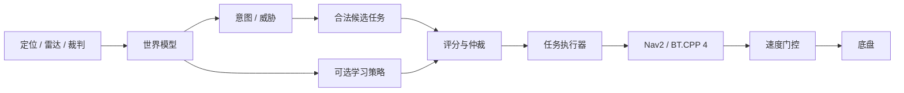

# SentryWeave · 织策

[](https://github.com/yelle233/SentryWeave/actions/workflows/ci.yml)
[](https://docs.ros.org/en/jazzy/)
[](https://www.python.org/)
[](LICENSE)

**Cooperative sentry decision making and offline navigation learning for ROS 2 Jazzy.**

SentryWeave 是面向 RoboMaster 哨兵的自主协同决策与离线学习框架。系统结合自身资源、队友运动趋势、
敌方威胁和区域覆盖，在支援、阻截、防守、恢复及保持任务之间选择，并通过 Nav2 执行导航。

项目提供可解释的规则基线、可训练的 HMM 意图模型，以及基于 RMUC 比赛日志的
**BC、IQL、Decision Transformer** 导航子目标学习。训练、回放与在线运行共用核心数据模型和约束。

| 项目信息 | 内容 |
|---|---|
| 项目名称 | SentryWeave（织策） |
| 所属战队 | **未来战队** |
| 维护者 | [yelle233](https://github.com/yelle233) |
| 联系邮箱 | [1376982098@qq.com](mailto:1376982098@qq.com) |

> 项目定位为研究与集成框架。示例场地、阈值和奖励不是官方赛季规则。
> 当前离线实验尚未证明 IQL 优于 BC 或既有规则策略；评测口径与限制见 [实验基线](docs/benchmarks.md)。

## 功能

- **战场状态**：统一坐标与源时间戳，跟踪敌我位置，处理缺帧、跳变、身份重建和未知状态。
- **协同决策**：概率意图、分区威胁、合法候选点、效用评分与任务防抖。
- **离线学习**：官方 SQLite 导入、整场分组划分、BC/IQL/DT 训练、独立评测和模型导出。
- **执行约束**：Nav2 Goal 生命周期管理、取消终态确认、任务租约、禁区过滤和速度门控。
- **仿真与回放**：轻量运动学场景、JSONL/rosbag2 回放、Harmonic + Nav2 物理导航验收。
- **部署接口**：Python/ROS 2 模块化实现，NumPy 模型推理，差速参考配置与 MPPI Omni 配置。



## 获取代码

```bash
git clone https://github.com/yelle233/SentryWeave.git
cd SentryWeave
```

支持环境为 **Ubuntu 24.04、Python 3.12、ROS 2 Jazzy、Gazebo Harmonic**。
纯 Python 决策与训练不需要安装 ROS；Docker 路线包含完整仿真依赖。

仓库发布源码、配置、测试和汇总实验指标。**官方数据库、第三方场地资产、训练权重及预构建镜像不随源码分发**，
分别通过下载脚本、训练命令和 Dockerfile 生成。

## 快速开始：不依赖模型的决策演示

```bash
python3 -m venv .venv
.venv/bin/python -m pip install -e '.[dev]'
.venv/bin/python -m pytest tests -q

.venv/bin/sentry-train simulate \
  --scenario conflict --seed 101 --duration 30 \
  --trace artifacts/demo/conflict.jsonl
.venv/bin/sentry-train replay --trace artifacts/demo/conflict.jsonl
```

该示例展示进攻机会与防区威胁同时存在时的任务选择。
输出包含任务序列、覆盖指标、切换次数和执行结果；没有 ROS 的环境会明确跳过 ROS 专用测试。

## 快速开始：Jazzy / Harmonic

在仓库根目录构建镜像：

```bash
docker build -t sentryweave:jazzy -f docker/Dockerfile .
mkdir -p artifacts
docker run --rm -it \
  -e LIBGL_ALWAYS_SOFTWARE=1 \
  -v "$PWD/artifacts:/ws/artifacts" \
  sentryweave:jazzy bash tools/ros_exec.bash \
  ros2 launch sentry_bringup simulation.launch.py \
  scenario:=team_push trace_path:=/ws/artifacts/decisions.jsonl
```

默认无 GUI，使用软件渲染；不要求 NVIDIA 容器支持。参考机器人包含差速底盘、激光和里程计，
队友与敌方状态由场景节点注入。

自动验证“队友推进 → 支援任务 → 实际导航到位”：

```bash
docker run --rm -e LIBGL_ALWAYS_SOFTWARE=1 \
  -v "$PWD/artifacts:/ws/artifacts" \
  sentryweave:jazzy bash tools/ros_exec.bash \
  python3 tools/gazebo_acceptance.py --out artifacts/physics
```

结果保存在 `artifacts/physics/`。GUI、本机 colcon 构建及故障排查见 [仿真指南](docs/simulation.md)。

## 训练离线强化学习策略

训练环境与 ROS 系统 Python 分开。以下 CUDA 示例适用于兼容 CUDA 12.8 的 NVIDIA 环境；
CPU 安装方式见 [入门教程](docs/getting-started.md)。

```bash
python3 -m venv .venv-rl
.venv-rl/bin/python -m pip install torch==2.9.1 \
  --index-url https://download.pytorch.org/whl/cu128
.venv-rl/bin/python -m pip install -e '.[dev,rl]'

.venv-rl/bin/sentry-rl fetch --out artifacts/rl/raw
.venv-rl/bin/sentry-rl build \
  --db artifacts/rl/raw/extracted/rmuc_2026_region_dataset.sqlite \
  --out artifacts/rl/dataset --roles mixed --horizon 5 --seed 29

.venv-rl/bin/sentry-rl train \
  --data artifacts/rl/dataset --algorithm bc --roles infantry \
  --steps 30000 --batch-size 512 --seed 7 --device auto \
  --out artifacts/rl/runs/bc-seed7
.venv-rl/bin/sentry-rl train \
  --data artifacts/rl/dataset --algorithm iql --roles infantry \
  --init-actor artifacts/rl/runs/bc-seed7/actor.json \
  --steps 30000 --batch-size 512 --seed 7 --device auto \
  --out artifacts/rl/runs/iql-seed7
```

训练输出 `actor.json`、safetensors 参数、配置和日志。
构建数据集或训练到已有完成目录时会拒绝覆盖，请使用新输出目录保存新实验。

独立评测：

```bash
.venv-rl/bin/sentry-rl evaluate \
  --data artifacts/rl/dataset \
  --actors artifacts/rl/runs/bc-seed7/actor.json artifacts/rl/runs/iql-seed7/actor.json \
  --out artifacts/rl/evaluation
```

完成训练后，在仿真中加载模型：

```bash
docker run --rm -it -e LIBGL_ALWAYS_SOFTWARE=1 \
  -v "$PWD/artifacts:/ws/artifacts" \
  sentryweave:jazzy bash tools/ros_exec.bash \
  ros2 launch sentry_bringup simulation.launch.py \
  rl_model:=/ws/artifacts/rl/runs/iql-seed7/actor.json \
  rl_blend:=0.25 rl_allow_transfer:=true
```

`rl_allow_transfer` 显式允许将官方数据的 28×15 m 模型用于 20×12 m 参考场地。
这验证集成与约束，不代表正式赛场性能。`rl_blend:=0.0` 为影子模式：记录模型建议，
任务仍由规则策略选择，规则策略仍可能驱动机器人。

DT、分组验证、FQE 和回放方法见 [离线强化学习](docs/offline-rl.md)。

## 项目目录

```text
SentryWeave/
├── src/
│   ├── sentry_core/         # ROS 无关的状态、策略、模型推理和执行协议
│   ├── sentry_training/     # HMM / BC / IQL / DT、评测与回放
│   ├── sentry_interfaces/   # ROS 消息
│   ├── sentry_ros/          # TF、QoS、节点和 Nav2 Action 适配
│   ├── sentry_bringup/      # launch、参数、导航行为树
│   └── sentry_gazebo/       # Harmonic 参考场地与机器人
├── tests/                  # 单元、ROS Action 与物理集成测试
├── tools/                  # 仿真验收、资产导入、坐标标定
├── integrations/           # 固定上游版本与许可信息
├── benchmarks/             # 可公开的实验汇总，不含原始比赛轨迹
├── docs/                   # 开发者与部署文档
├── docker/                 # Jazzy 运行环境
└── .github/                # CI 与协作模板
```

`artifacts/`、`third_party/`、虚拟环境和 colcon 构建产物在运行时生成，不进入版本控制。

## 文档

| 主题 | 入口 |
|---|---|
| 从首次克隆开始训练与运行 | [入门教程](docs/getting-started.md) |
| 数据流、决策与执行协议 | [系统架构](docs/architecture.md) |
| BC / IQL / DT 与官方数据 | [离线强化学习](docs/offline-rl.md) |
| 规则、HMM、效用权重与标注 | [学习基线](docs/baselines.md) |
| Docker、Gazebo、GUI 与验收 | [仿真指南](docs/simulation.md) |
| ROS 接口、TF、实车参数 | [部署指南](docs/deployment.md) |
| PolarBear / RMU 适配 | [上游集成](docs/integrations.md) |
| 实验结果与解释边界 | [实验基线](docs/benchmarks.md) |
| 官方文档与论文 | [参考资料](docs/references.md) |

## 开发与贡献

```bash
.venv/bin/ruff check src tests tools
.venv/bin/python -m pytest tests -q
```

离线学习测试需要 `.[rl]`，ROS 测试需要已构建并 source 的 Jazzy 工作区。
CI 分别检查纯 Python、CPU PyTorch 和 Jazzy/Harmonic。

欢迎提交 [Issue](https://github.com/yelle233/SentryWeave/issues) 或 Pull Request。
开发环境、提交范围与验证要求见 [CONTRIBUTING.md](CONTRIBUTING.md)。

## 许可证与致谢

源码使用 [Apache License 2.0](LICENSE)。
第三方源码、场地、比赛数据和商标的适用范围见 [THIRD_PARTY_NOTICES.md](THIRD_PARTY_NOTICES.md)。

项目参考并感谢：

- [SMBU PolarBear · pb2025_sentry_nav](https://github.com/SMBU-PolarBear-Robotics-Team/pb2025_sentry_nav)
- [SMBU PolarBear · rmu_gazebo_simulator](https://github.com/SMBU-PolarBear-Robotics-Team/rmu_gazebo_simulator)
- [Navigator Team · RMUC-OfflineRL](https://github.com/Harkerbest/RMUC-OfflineRL)
- [Navigation2](https://github.com/ros-navigation/navigation2) 和 [Gazebo](https://gazebosim.org/)

SentryWeave 由未来战队维护，是独立研究项目，不代表 DJI/RoboMaster 官方规则、认证或背书。
