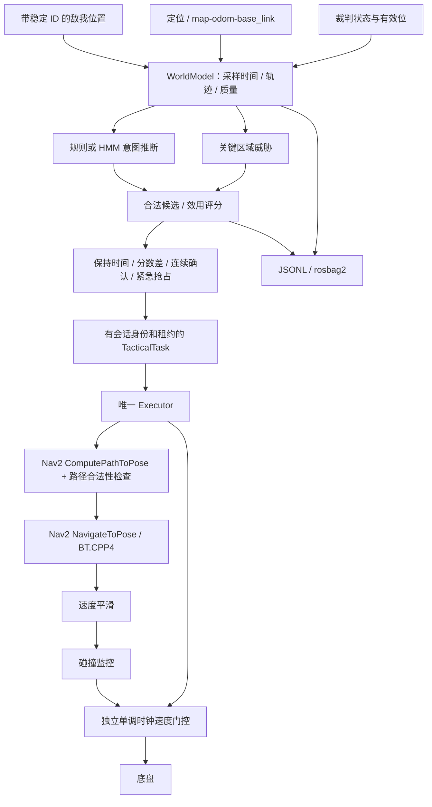

# 系统架构

## 运行闭环



首版战术层用 Python 实现，默认 2 Hz；原始观测和世界模型 10 Hz。
核心计算不需要 ROS 或 GPU。仿真、训练、回放和在线节点调用相同的
`WorldModel`、`IntentEstimator`、`DecisionEngine` 和 `Executor`。

上层不用第二棵战术行为树：单一执行状态机负责异步 Goal 所有权，避免 BT `halt()` 与外部
任务仲裁同时抢占。下层 Nav2 行为树仍负责规划、控制和有界恢复；XML 为 BT.CPP4 格式。
生产入口使用单线程 ROS executor 串行处理状态事件；将节点嵌入其他执行框架时也应维持这一约定。

## 世界模型和领域含义

`Observation` 是源采样数据，`Track` 是带质量和代龄的估计，`World` 是不可变快照。
敌我机器人按 `(team, robot_id)` 隔离；短时缺帧可预测，超过 `predicted_age` 不再作为任务证据。
位置不 finite、越界、明显乱序、未来时间或异常跳变被拒绝；跳变需后续观测确认再重建身份。
连续重建、失联重现会改变 `generation`，旧意图记忆随之清空。

自身位姿直接保留定位系统的输出，不再次做轨迹平滑或外推。否则绕障时会把真实拐角平滑进墙内。
外部雷达消息不能覆盖自身定位。定位失效既可由时间判断，也可由独立 `localization_ok` 通知。

血量、弹量、前哨站存活、补给可用性都包含显式“未知”状态。未知血量不是零血量；
未知前哨站状态不能被当成已经摧毁。比赛阶段未知、非 RUNNING、裁判过期或自身失效时输出 HOLD。

## 意图推断与学习

标签固定为：

| 标签 | 含义 |
|---|---|
| UNKNOWN | 没有足够或一致的证据 |
| ATTACK_OUTPOST | 轨迹倾向于前哨站相关进攻区域 |
| DEFEND_BASE | 倾向于己方关键防区 |
| CONTEST_AREA | 倾向于争夺区 |
| RETREAT | 倾向于合法恢复区；不假设已知队友低血量 |
| TRANSIT | 在移动，但战术目标不明确 |

24 维特征包含速度、质量、历史时长、速度有效性，以及四类目标各自的方向一致性、
路径进展、区域占据、接近程度和可达性。路径使用带障碍膨胀的可见图估计。
如果前哨站/基地中心是实体障碍，改用该区域标定的可达战术点计算接近趋势。

规则模型产生归一化分布；可选 HMM 学习 Gaussian emission、状态转移和初始概率。
仅新观测推进滤波，重复 World 消息不会人为增加置信度。低质量、短历史、失联仍由硬条件
回到 UNKNOWN，不允许模型覆盖这些条件。置信度还乘以轨迹质量和前两类概率的区分程度。

模型需要标注队友“实际执行的目标”，不是给每个位置机械贴标签。合成轨迹主要用于检查训练管线；
真实意图不可仅凭位置确定，因此必须保留 UNKNOWN/TRANSIT。

## 离线导航策略

可选 BC/IQL/DT 使用 73 维可部署观测，输出短期导航位移建议。
`GoalPrior` 将建议和合法候选路线投影到相同行进距离，再按 `rl_blend` 混合原效用。
模型不修改候选坐标、紧急标记、资源条件或执行协议。

训练使用 PyTorch，运行使用经过一致性测试的 NumPy 导出。
DT 历史记录已经发生的位移；小位移、已到达、越界或失效建议按约定回退。
`rl_blend=0` 为影子模式，保留原任务但记录模型输出。
具体观测、宏转移与评测边界见 [离线强化学习](offline-rl.md)。

## 任务生成、评分与稳定性

任务为 HOLD、SUPPORT、INTERCEPT、DEFEND、RECOVER。支援目标是补充覆盖的标定点，
不会把队友当前位置当导航终点。路径不可达、队友占位、依赖观测过期、资源不充分、
前哨站未确认存活或补给不可用时，先删除对应候选，再比较分数。

六维特征为战略收益、协同增益、紧迫性、风险、路程和切换代价。权重非负且总和为 1，
评分将后三项转换为 `1-risk / 1-travel / 1-switching`，结果保持在 `[0,1]`。
HOLD 是兜底候选，不会通过低风险常量在正常情况下压过合法任务。

任务键包含任务类型、区域、相关机器人和战术点。普通切换需满足保持时间、相对当前最新评分的
差值、连续胜出次数；合法且紧迫的防区威胁或资源恢复可抢占。当前任务失效立即重评估。
失败点按点位冷却，反馈必须匹配当前会话和任务身份。

到位表示导航成功，任务仍可持续驻守。同一任务的心跳只续租，不重发 Goal。
由于看门狗而取消的当前任务在恢复后获得新身份，避免一直续租一个已取消的 Goal。

## 执行协议

执行器启动时先处理该 namespace 中可能遗留的导航：请求取消全部旧 Goal，逐个等待
GetResult 终态，确认旧控制权释放后才接受新任务。等待期间速度许可关闭。
这覆盖“执行器进程重启，但 Nav2 仍在执行旧 Goal”的情况。
取消服务可能遗漏已经处于 CANCELING 的 Goal，因此清理时同时合并 Action 状态快照。
运动许可还要求状态流确认当前 Goal 独占；检测到其他客户端的活动 Goal 时关闭许可并锁定故障。

```text
IDLE -> PLANNING -> SENDING -> RUNNING -> ARRIVED
                      |          |
                等待迟到接收     CANCELING --终态结果--> 下一任务
                      |          |
                      +----超时/拒绝取消----> FAULT
```

- 新任务先调用当前 Nav2 规划器，检查返回路径坐标系、终点和每段的规则合法性。
- `SENDING` 阶段收到抢占时先等 Goal 接收结果；迟到接受的 Goal 仍需取消。
- 取消服务响应只表示请求被处理；必须等导航 Action 的终态 Result 才释放所有权。
- 已结束 Goal 的取消响应也继续等待其 Result；不会盲目叠加导航。
- 旧 token 的结果不覆盖新任务。进程重启用会话 UUID 避免任务 ID 冲突。
- 接收/规划/取消超时进入锁定 FAULT，速度许可撤销。未决导航未释放时不能 reset。
- 暂时缺少健康 World 时保留尚未启动的新任务；恢复后仍检查租约，不丢失待执行任务。
- `/executor/reset_fault` 成功后，还需新鲜世界状态和任务心跳。

除了首次路径检查，战术禁区还被投影到完整导航地图，作为全局和局部 costmap 的
`KeepoutFilter`。过滤后有单独的 InflationLayer，因此 Nav2 后续重规划和恢复也受约束；
清空障碍代价图不会撤销规则掩码。掩码按地图原点、分辨率和旋转生成，PNG/PGM 均支持。

## 时间和控制权

观测、轨迹、任务租约使用 ROS time；执行超时、世界状态心跳和速度门控使用单调时钟。
因此暂停 `/clock` 不会让最后一条速度永久有效。时间倒退会清空世界记忆并使执行器锁定，
回放或仿真重置后需重建运行状态。

默认底盘控制链：

```text
controller/behavior_server -> cmd_vel_raw
velocity_smoother          -> cmd_vel_smoothed
collision_monitor         -> nav_cmd_vel
velocity_guard            -> cmd_vel
```

Jazzy 各环节显式使用 `geometry_msgs/Twist`。执行器默认 0.75 s 收不到有效 World 即撤销许可；
速度门控默认许可超时 0.3 s、命令超时 0.25 s。硬件驱动仍需自己的速度超时停车，
因为软件进程全部退出后无法继续发送零速。
