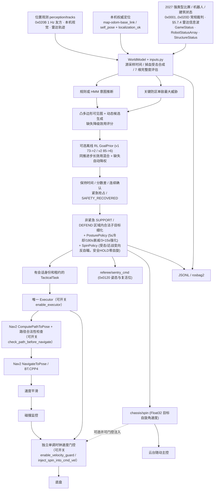

# 系统架构

## 运行闭环



首版战术层用 Python 实现，常规周期 2 Hz，并在临界状态变化或收到新装甲受击事件（`0x0206` / 掉血合成）时跳过定时器 `< 100 ms` 立即重决策；原始观测和世界模型 10 Hz。
核心计算不需要 ROS、PyTorch 或 GPU。仿真、训练、回放和在线节点调用相同的
`WorldModel`、`IntentEstimator`、`DecisionEngine`（内置 `PosturePolicy` 与 `SpinPolicy`）和 `Executor`。

上层不用第二棵战术行为树：单一执行状态机负责异步 Goal 所有权，避免 BT `halt()` 与外部
任务仲裁同时抢占。下层 Nav2 行为树仍负责规划、控制和有界恢复；XML 为 BT.CPP4 格式。
第三方导航栈也可关闭内置 `Executor` 与速度门控，直接消费 `TacticalTask` 或桥接 `PoseStamped`（见 [接入自有导航栈](navigation-integration.md)）。
生产入口使用单线程 ROS executor 串行处理状态事件；将节点嵌入其他执行框架时也应维持这一约定。

## 世界模型和领域含义

`Observation` 是源采样数据，`Track` 是带质量和代龄的估计，`World` 是不可变快照。
敌我机器人按 `(team, robot_id)` 隔离；轨迹经历 `OBSERVED`（`<= observed_age`）、`PREDICTED`（`<= predicted_age`）与 `STALE`（`<= retention`）三阶段：
超过 `predicted_age` 的轨迹不再作为新增进攻或协同意图证据，但敌方陈旧位置在 `retention` 内仍以线性衰减权重（`stale_enemy_weight`）参与己方核心防区威胁兜底。
位置不 finite、越界、明显乱序、未来时间或异常跳变被拒绝；跳变需后续观测确认再重建身份。
连续重建、失联重现会改变 `generation`，旧意图记忆随之清空。

自身位姿直接保留定位系统的输出，不再次做轨迹平滑或外推。否则绕障时会把真实拐角平滑进墙内。
外部雷达消息（`perception/tracks` 中 `ALLY + self_id` 条目）会被自动忽略，不能覆盖自身定位。
定位失效既可由源时间戳超时判断，也可由独立 `localization_ok` 通知。

输入融合层（`sentry_core/inputs.py` 的 `view_inputs` 与 `assess`）将多源强类型输入（`GameState`、`RobotStatus`、`StructureState`）与旧版兼容 `Referee` 合并为统一的只读视图：
- **新接口优先、分字段独立超时与掉血受击合成**：同一语义字段只要强类型接口有效且未超过对应类别超时（`game_timeout`、`robot_status_timeout`、`structure_timeout`），始终覆盖旧版 `Referee`（`referee_timeout`）。`RobotStatus.last_hit_stamp` 与 `hit_armor_id` 采用独立记忆窗口 `hit_timeout`（默认 `5.0 s`），自动忽略上游持续重发的超期历史受击时刻而不拒绝同包新鲜血量/姿态；若上游未接 `0x0206` 伤害帧但本机有效 `hp` 较上一未过期帧下降，`WorldModel` 自动合成 `last_hit_stamp` 兜底。
- **统一“未知”语义（`None`）**：无效位（`*_valid=false`）或超时过期的数据统一归为 `None`，绝不当作零血量、零弹量或建筑已摧毁。例如前哨站状态未知时按“存活但未确认”折减进攻收益（`unconfirmed_attack_factor`），敌方血量未知时不叠加残血优先加分。
- **7 维信息完整度评估（对齐 2027 物理链路边界）**：`assess` 每周期统计 `game`、`self`、`allies`、`enemies`、`ally_status`、`enemy_status`、`structures` 七类 `[0, 1]` 完整度与具体缺失键（输出至 `missing_info`）。其中 `ally_status`（`0x0003` 己方队友血量）、`structures`（`0x0003` 双方建筑血量）与 `0x020B`（1 Hz 友方位置保底）属常规机载裁判直连，在雷达全盲时依然常通；而本机视野外敌方位置（`enemies`）与敌方血量（`enemy_status`，对应雷达 §5.7.4 无线电信息波解调）独立度量，已确认阵亡的机器人自动从期望在线分母中剔除。
- **安全停机条件**：坐标系不匹配、本机定位失效、比赛阶段未知或非 `RUNNING`、`GameStatus.own_team` 与节点配置不一致（`TEAM_MISMATCH`）或本机阵亡/断电时立即输出紧急 `HOLD`（同时强制 `spin_enabled=False`、`posture_enhanced=False`）。各字段完整契约见 [开放输入输出接口](interfaces.md)。

## 意图推断与学习

标签固定为：

| 标签 | 含义 |
|---|---|
| UNKNOWN | 没有足够或一致的证据 |
| ATTACK_OUTPOST | 轨迹倾向于前哨站相关进攻区域 |
| DEFEND_BASE | 倾向于己方关键防区 |
| CONTEST_AREA | 倾向于争夺区 |
| RETREAT | 倾向于合法恢复区；不假设已知队友低血量 |
| TRANSIT | 在移动，但战术目标不明确 |

24 维特征包含速度、质量、历史时长、速度有效性，以及四类目标各自的方向一致性、
路径进展、区域占据、接近程度和可达性。路径使用带障碍膨胀的可见图估计。
如果前哨站/基地中心是实体障碍，改用该区域标定的可达战术点计算接近趋势。

规则模型产生归一化分布；可选 HMM 学习 Gaussian emission、状态转移和初始概率。
仅新观测推进滤波，重复 World 消息不会人为增加置信度。低质量、短历史、失联仍由硬条件
回到 UNKNOWN，不允许模型覆盖这些条件。置信度还乘以轨迹质量和前两类概率的区分程度。

模型需要标注队友“实际执行的目标”，不是给每个位置机械贴标签。合成轨迹主要用于检查训练管线；
真实意图不可仅凭位置确定，因此必须保留 UNKNOWN/TRANSIT。

## 离线导航策略

可选 BC/IQL/DT 支持 v1（`73 -> 2` 归一化位移）与 RMUC 2027 v2（`85 -> 6` 联合位移 + 三姿态/强化 logits）双版本纯 NumPy 策略（通过三态 `rl_mirror` 在红蓝镜像场地间自动规范化）。
在线策略采用**双层受限机制**接入决策链，绝不允许神经网络绕过规则约束或直接生成任意任务：

1. **同推进距离路线效用混合**：`GoalPrior.rank` 先将模型建议裁剪至合理步长并投影为同连通分量最近合法点，再把各可行规则候选路线推进相同距离，按高斯接近度与 `effective_blend` 混合原规则效用（模型建议本身不作为独立候选参选）。
2. **胜出后只细化合同（Refine-Only）与受约束姿态混合**：经过保持时间/确认/抢占仲裁选出胜出任务后，投影合法子目标**仅允许细化已胜出的非紧急 `SUPPORT` 或 `DEFEND` 任务的目标坐标**——且必须落在该任务区域内或距原规则目标 `<= 1.5 m`（`goal_update_distance`）、可见图可达并通过失败冷却与友军间距（`ally_clearance`）筛选；**绝不改变胜出任务的类型、所属区域、关联机器人 ID 或紧急标志**。v2 模型的姿态与强化概率同样只在 `PosturePolicy` 的重伤硬生存覆盖、`5.0 s` 冷却与 `3×15.0 s` 强化上限屏障之内按 `effective_blend` 混合。若细化子目标导航失败，仅对 `rl_subgoal` 施加冷却并立即恢复原规则目标点；若模型新建议已到达或位移过小暂不可转向，已细化任务保持当前子目标而不跳回原规则点。
3. **信息残缺自动降权与影子模式**：当 `allies` 或 `enemies` 位置完整度低于 `completeness_threshold`（默认 `0.6`）时，引擎按比例自动降低当周期 `effective_blend` 直至 `0`（退回 `SHADOW`）；配置 `rl_blend=0` 时严格为影子模式，对导航目标与哨兵姿态均保证零干预，仅在 `policy_info` 中记录模型建议与概率。

训练使用 PyTorch，车载运行使用经过逐算子一致性测试的纯 NumPy 导出（零 PyTorch/CUDA 依赖）。
DT 上下文只记录已经发生的真实位移与已执行姿态，不写入未执行的计划动作。
具体观测、宏转移与评测边界见 [离线强化学习](offline-rl.md)。

## 任务生成、评分与稳定性

几何与路径层（`TacticalMap`）支持 `schema_version: 2` 独立场地语义文件（凸多边形障碍 `obstacles`、规则禁区 `keepouts`、建筑 `structures`、补给区 `supply`、多边形/圆形 `zones` 与 `mirror: auto` 红蓝 180° 自动镜像），结合按 `robot_radius` 膨胀的**凸多边形可见图**与**自由空间栅格连通分量**计算最短合法路径。

任务类型为 `HOLD`、`SUPPORT`、`INTERCEPT`、`DEFEND`、`RECOVER`。场地文件中的 `points` 仅为非白名单的**可选偏好点**（`preferred`），`GoalGenerator` 每周期还会依据实时态势在当前连通自由空间动态生成**拦截点（`intercept`）、防区驻守点（`defense`）、队友侧翼支援点（`support`）、争夺区控制点（`contest`）与补给恢复点（`recovery`）**共六类候选点（支援目标是侧翼补充覆盖点，绝不把队友当前坐标当导航终点）。

- **观测起点吸附 vs 目标严格合法**：所有候选目标点与执行目标均严格执行 `arena.legal(goal)`（距场地边界、障碍与禁区均 `>= robot_radius`）；而当实车观测位姿因定位抖动或贴墙机动落入膨胀裕度内（仍在场地 `in_bounds` 内）时，路径起点由 `arena.origin(pos)` 吸附到最近合法栅格再计算连通性与路径长度，防止贴墙自锁 `LOCALIZATION_INVALID`。
- **防区威胁恒取最大值与缺失补偿**：每个核心防区的 `Threat.score`（发布于 `threat/state` 并决定 `INTERCEPT` 是否达到 `urgent_threat`）恒取该防区内单台敌方威胁分数的最大值；已知敌方残血加分（`enemy_low_hp_bonus`）只影响优先选定哪台 `enemy_id` 及其 `eta_sec`。敌方位置不完整时按 `missing_enemy_defense_boost * (1 - completeness["enemies"])` 自动抬高核心防区 `DEFEND` 紧迫度；队友位置不完整时按 `0.5 + 0.5 * completeness["allies"]` 保守缩放支援协同增益。
- **硬过滤优先于加权评分**：路径不可达、不在同一连通分量、队友占位、依赖观测过期、资源不充分、目标建筑已确认摧毁或补给不可用时，先删除对应候选，再比较六维效用（战略收益、协同增益、紧迫性、风险、路程、切换代价；非负权重和为 1，后三项取 `1 - x`，总分保持在 `[0, 1]`）。`HOLD` 仅为兜底候选，不会在正常情况下压过合法任务。
- **可选模型地图指纹安全回退**：当挂载的 `intent_model`（HMM）或 `utility_model` 与当前加载场地的 `map_fingerprint` 不一致（例如蓝方 `mirror: auto` 镜像改变了地图指纹，或更换场地后沿用旧模型）时，在线节点不会报错退出，而是自动回退到规则意图估计或战术文件默认权重，并在启动日志与每帧 `policy_info["model_fallbacks"]` 中记录原因。
- **2027 哨兵姿态状态机（`PosturePolicy`）与响应式小陀螺（`SpinPolicy`）**：在胜出任务与子目标细化确定后，同步计算姿态与自旋并写入 `Task` 及 `policy_info.{posture, spin}`：
  - `PosturePolicy` 对齐 `0x020D` 裁判反馈（未接时本地积分兜底），遵守 **`5.0 s` 切换冷却**与 **`3×15.0 s` 独立强化上限**；无威胁巡航或平静驻守默认保持 `"move"`，为真实交火和高威胁防守保留 `"attack"`（3× 冷却）与 `"defense"`（50% 减伤）各 **`180.0 s` 未衰减预算**；重伤撤退强制锁定 `SURVIVAL_DEFENSE`（可用强化 99% 减伤），高枪口热量（`>= 0.75`）切 `THERMAL_RELIEF_ATTACK` 快冷。
  - `SpinPolicy` 在受击保持窗（`<= 3.5 s`）、近敌交火（`<= 7.0 m`）、紧急 `INTERCEPT` 或受击 `RECOVER` 锁存期输出默认 `±7.0 rad/s` 目标自旋，并按 `2.2 s` 周期或间隔 `>= 0.6 s` 的新受击事件自动翻转符号以破坏敌方自瞄预测；无威胁机动与平静驻守自动停旋，**任何安全 `HOLD` 下严格输出 `0.0`**。

任务键包含 `(任务类型, 区域, 相关机器人, 规则目标 ID)`。普通切换需同时满足最短保持时间（`min_hold`）、分数优势（`switch_margin`）与连续胜出次数（`confirm_cycles`）；合法且紧迫的防区威胁或低资源恢复可立即抢占（`URGENT_PREEMPT`）；当前任务失效立即重评估（`CURRENT_INVALID`）。
安全原因（坐标系、定位、比赛阶段、队伍不一致、本机阵亡）造成的紧急 `HOLD` 在恢复安全的首个周期零延迟切换为最优任务，仲裁记为 `SAFETY_RECOVERED`，新任务从此刻起重新计保持时间。
若同一任务的目标坐标移动超过 `goal_update_distance`（默认 `1.5 m`），以 `GOAL_MOVED` 递增 `task_id` 通知下游更新导航终点，同时延续原有的保持起始时刻。
失败点按 `goal_id` 冷却（默认 `5.0 s`），反馈必须匹配当前 `(session_id, task_id)`。

到位表示导航成功，任务仍可持续驻守。同一任务的心跳只续租，不重发 Goal（续租期间更新 `posture` 或 `spin_rate_rad_s` 同样不会重置导航 Goal）。
由于看门狗而取消的当前任务在恢复后获得新身份，避免一直续租一个已取消的 Goal。

## 执行协议

执行器启动时先处理该 namespace 中可能遗留的导航：请求取消全部旧 Goal，逐个等待
GetResult 终态，确认旧控制权释放后才接受新任务。等待期间速度许可关闭。
这覆盖“执行器进程重启，但 Nav2 仍在执行旧 Goal”的情况。
取消服务可能遗漏已经处于 CANCELING 的 Goal，因此清理时同时合并 Action 状态快照。
运动许可还要求状态流确认当前 Goal 独占；检测到其他客户端的活动 Goal 时关闭许可并锁定故障。

```text
IDLE -> PLANNING -> SENDING -> RUNNING -> ARRIVED
   |                   |          |
   +-(跳过预检时直发)-> 等待迟到接收  CANCELING --终态结果--> 下一任务
                       |          |
                       +----超时/拒绝取消----> FAULT
```

- 新任务默认先调用 Nav2 `ComputePathToPose`（`PLANNING`），检查返回路径坐标系、终点和每段采样的规则合法性；若外部导航栈未开放路径预检 Action 或代价图膨胀半径小于战术 `robot_radius`，可通过参数 `check_path_before_navigate:=false` 跳过 `PLANNING` 直入 `SENDING`（目标点本身的 `arena.legal(goal)` 检查与代价图 `KeepoutFilter` 始终保留）。
- `decision.launch.py` 同时提供 `enable_executor` 与 `enable_velocity_guard` 开关（默认均为 `true`）：接入 `PoseStamped` 目标话题规划器或直接消费 `TacticalTask` 的自研底盘主控时，可将二者设为 `false`，避免内置执行器等待 Nav2 Action Server 或速度门控向 `cmd_vel` 持续发送零速抢占控制权。三种接入拓扑详见 [接入自有导航栈](navigation-integration.md)，话题与消息定义见 [开放输入输出接口](interfaces.md)。
- `SENDING` 阶段收到抢占时先等 Goal 接收结果；迟到接受的 Goal 仍需取消。
- 取消服务响应只表示请求被处理；必须等导航 Action 的终态 Result 才释放所有权。
- 已结束 Goal 的取消响应也继续等待其 Result；不会盲目叠加导航。
- 旧 token 的结果不覆盖新任务。进程重启用会话 UUID 避免任务 ID 冲突。
- 接收/规划/取消超时进入锁定 FAULT，速度许可撤销。未决导航未释放时不能 reset。
- 暂时缺少健康 World 时保留尚未启动的新任务；恢复后仍检查租约，不丢失待执行任务。
- `/executor/reset_fault` 成功后，还需新鲜世界状态和任务心跳。

除了首次路径检查，战术禁区还被投影到完整导航地图，作为全局和局部 costmap 的
`KeepoutFilter`（随 `own_team` 与 `mirror: auto` 自动镜像）。过滤后有单独的 InflationLayer，因此 Nav2 后续重规划和恢复也受约束；
清空障碍代价图不会撤销规则掩码。掩码按地图原点、分辨率和旋转生成，PNG/PGM 均支持。

## 时间和控制权

观测、轨迹、任务租约使用 ROS time；执行超时、世界状态心跳和速度门控使用单调时钟。
因此暂停 `/clock` 不会让最后一条速度永久有效。时间倒退会清空世界记忆并使执行器锁定，
回放或仿真重置后需重建运行状态。

默认控制输出链：

```text
decision ────────────────────────────────────────► referee/sentry_cmd (0x0120 姿态与复活掩码)
decision ────────────────────────────────────────► chassis/spin (云台随动主控 / 可选注入门控)
controller/behavior_server -> cmd_vel_raw
velocity_smoother          -> cmd_vel_smoothed
collision_monitor          -> nav_cmd_vel
velocity_guard             -> cmd_vel
```

Jazzy 各环节显式使用 `geometry_msgs/Twist`。执行器默认 0.75 s 收不到有效 World 即撤销许可；
速度门控默认许可超时 0.3 s、命令超时 0.25 s；当开启 `inject_spin_into_cmd_vel:=true` 时，`chassis/spin` 同样严格受 `MotionPermit.allowed == True` 与 `spin_timeout = 1.0 s` 门控，许可撤销即强制输出零速。硬件驱动仍需自己的速度超时停车，
因为软件进程全部退出后无法继续发送零速。
