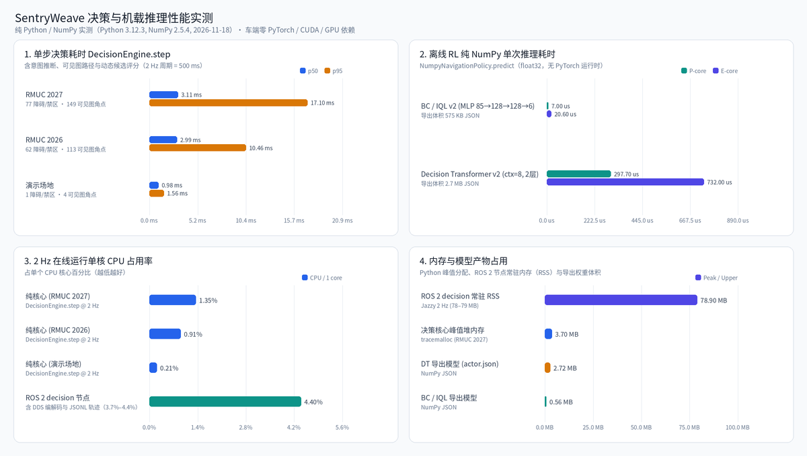

# 实验基线与验证范围

本页记录可复现的离线学习评估、机载运行开销与多局面仿真鲁棒性实验，不提供真实比赛胜率或官方认证结论。
机器可读汇总见 [`benchmarks/rmuc2026-navigation.json`](../benchmarks/rmuc2026-navigation.json)、
[`benchmarks/decision-latency.json`](../benchmarks/decision-latency.json) 与
[`benchmarks/runtime-footprint.json`](../benchmarks/runtime-footprint.json)；
仓库不分发原始比赛记录、逐帧预测、训练权重或外部闭源/非商业模拟器。

## 协议

实验记录日期为 2026-11-05，使用公开 RMUC 2026 数据。
SQLite SHA-256 为 `53ac64efeaf570c0e21d8c3724dcefcb0123196b3c7ef963183a911863f724a7`。

| 集合 | 场次组 | 局数 | 宏转移 |
|---|---:|---:|---:|
| train | 186 | 431 | 186,690 |
| validation | 39 | 87 | 37,807 |
| test | 41 | 95 | 41,368 |

按 `(赛区, 场次号)` 分组，split seed=29。
主训练使用 121,741 条步兵宏转移；同域测试 27,591 条，哨兵迁移测试 13,777 条。
观测 73 维、动作 2 维、宏时长最长 5 s，每秒 gamma=0.99。
这些定义不同于上游完整交战动作任务，指标不能直接与其目标分类准确率比较。

BC/IQL 各 30,000 更新、batch=512；DT 15,000 更新、batch=64、context=8。
三个方法均使用 seeds 7/19/43。IQL actor 从同 seed BC 初始化。
checkpoint 由验证集移动/静止平衡终点误差选择，测试集不参与模型选择。

参考环境：Python 3.12.3、PyTorch 2.9.1+cu128、RTX 5070 12 GB。
详细结构和实验设置保存在汇总 JSON 中。

## 独立轨迹测试

平均终点误差，单位米，较小表示更接近日志中的后续位置：

| 策略 | 步兵总体 | 步兵移动样本 | 哨兵总体 | 哨兵移动样本 |
|---|---:|---:|---:|---:|
| 零位移 | 2.1480 | 3.1403 | 0.8513 | 2.2562 |
| 因果恒速 | 3.2609 | — | 1.8570 | — |
| BC | 1.9043 | 2.4700 | 1.2232 | 2.0918 |
| IQL | 1.9384 | 2.4758 | 1.2862 | 2.0997 |
| DT | 2.0086 | 2.5910 | 1.1696 | 2.0717 |

步兵总体误差的 seed 标准差分别为 0.0090、0.0021、0.0168 m。
哨兵只有约 31.25% 的宏步移动超过 0.5 m，零位移基线很强；
较低总体误差不能单独证明更好的战术。

IQL 在该轨迹拟合口径下未超过 BC。该结果也不能反向证明 IQL 在所有战术收益上更差：
轨迹拟合与真实收益是不同目标，目前缺少支持更强结论的闭环证据。

## FQE

同域 BC/IQL 各拟合两个 FQE critic（seeds 17/23，各 8,000 更新）。
相对同训练 seed BC，IQL 的均值差约为 +0.0284 和 +0.0003。
这些变化受部分可观测性、截断和动作支撑集影响，不构成胜率提升证据。
未对 DT 使用无历史的 Markov FQE。

## 受约束的闭环

在 20×12 m 运动学参考环境中使用 seeds 701/702/703，10 类场景、每次 30 s。
这是显式域迁移，不能代替官方场地评测。
用于闭环的 BC/IQL/DT 分别是 seed19/43/7，
依据完整步兵验证集选出；独立测试结果未参与这项选择。

| 策略，blend=0.25 | 代理奖励 | 支援覆盖 | 防区覆盖 | 平均切换 |
|---|---:|---:|---:|---:|
| fixed | 1.1058 | 0.8434 | 0.0696 | 0.70 |
| rule | 0.9004 | 0.3021 | 0.8965 | 3.70 |
| BC prior | 0.9024 | 0.3036 | 0.9140 | 3.80 |
| IQL prior | 0.8861 | 0.3071 | 0.8401 | 3.87 |
| DT prior | 0.8070 | 0.2603 | 0.8330 | 5.07 |

blend=1.0 时，BC/IQL/DT 的代理奖励为 0.7229/0.7122/0.5849。
非法目标和失效定位下运动计数均为 0，主要来自约束实现，不能归功为模型自行学会安全规则。
这些结果支持保留规则基线与影子/混合模式，而非直接全面替换控制策略。

## Jazzy 物理仿真集成

以下结果在作者的物理仿真环境中测得（Nav2 1.3.13、Gazebo Harmonic 8.15.0、BehaviorTree.CPP 4.10.0），
该环境不属于本仓库。NumPy actor 在没有 PyTorch 的运行镜像中完成以下验收：

| 指标 | IQL | DT |
|---|---:|---:|
| 实际位移 | 12.058 m | 12.075 m |
| 模型评分次数 | 22 | 6 |
| 到位任务 | SUPPORT | SUPPORT |
| 执行故障 | 0 | 0 |

验证覆盖激光、里程计、World、禁区掩码、模型实际评分和 NavigateToPose 终态。
底盘为差速参考模型；MPPI Omni 已做参数配置验证，未据此宣称全向实车动力学已验证。
队友为脚本观测，未模拟完整对战。

## 决策耗时与机载运行开销

机载运行时核心仅依赖 `numpy` 与 `PyYAML`，不需要 GPU、PyTorch 或 CUDA。所有实测数字保存在 [`benchmarks/decision-latency.json`](../benchmarks/decision-latency.json) 与 [`benchmarks/runtime-footprint.json`](../benchmarks/runtime-footprint.json) 中，由 [`tools/plot_benchmarks.py`](../tools/plot_benchmarks.py) 纯数据驱动渲染：



### 单步决策耗时（`DecisionEngine.step`）

以下结果于 2026-11-18 由 `tools/benchmark_decision.py` 在 Python 3.12.3、NumPy 2.5.4（x86_64，单线程 BLAS）上对每张地图连续执行 200 步测得（含轨迹意图推断、分防区威胁评估、凸多边形可见图最短路、含 `enemy_front` 的动态候选生成、六维效用仲裁、2027 哨兵姿态 `PosturePolicy` 与受击小陀螺 `SpinPolicy`；2 Hz 决策预算为 `500 ms`）：

| 场地配置 | 障碍 / 禁区数 | 可见图角点数 | 建图初始化 | p50 (ms) | p95 (ms) | mean (ms) | max (ms) | 2 Hz 单核 CPU 占比 | Python 峰值堆内存 |
|---|---:|---:|---:|---:|---:|---:|---:|---:|---:|
| `rmuc2027`（规则 + 姿态/小陀螺） | 77 | 149 | 120.03 ms | 3.11 | 17.10 | 6.74 | 50.46 | 1.35% | 3.70 MiB (3791.2 KiB) |
| `rmuc2027`（挂载 v2 IQL `85→6`） | 77 | 149 | 126.60 ms | 4.76 | 19.48 | 8.35 | 51.82 | 1.67% | 4.90 MiB (5019.9 KiB) |
| `rmuc2026`（28×15 m） | 62 | 113 | 45.14 ms | 2.99 | 10.46 | 4.54 | 29.29 | 0.91% | 2.05 MiB (2098.6 KiB) |
| `demo`（20×12 m） | 1 | 4 | 0.28 ms | 0.98 | 1.56 | 1.06 | 2.17 | 0.21% | 1.30 MiB (1328.5 KiB) |

该基准仅计纯 Python 决策核心开销，不包含激光 SLAM、Nav2 局部控制器或真实传感器驱动负载。

### 纯 NumPy 离线 RL 前向耗时与 ROS 2 节点占用

| 测量项 | P 核单次耗时 | E 核单次耗时 | 产物 / 内存占用 | 说明 |
|---|---:|---:|---:|---|
| BC / IQL v2（MLP `85→128→128→6`） | 7.0 μs | 20.6 μs | 574.6 KiB `actor.json` | 走位 + 2027 姿态/强化联合输出（v1 `73→2` 为 `6.4 / 17.8 μs`、`534.6 KiB`） |
| Decision Transformer v2（`85→6`, `ctx=8`, 2 层） | 0.30 ms (297.7 μs) | 0.73 ms (732.0 μs) | 2.73 MiB (2790.3 KiB) `actor.json` | 含因果自注意力与 LayerNorm 纯 NumPy 实现（v1 为 `296.3 / 727.6 μs`） |
| ROS 2 Jazzy `decision` 节点（2 Hz + 受击即发） | — | — | 单核 CPU 3.7%–4.4%，RSS 77.6–78.9 MiB | 含 `WorldState` 解码、2027 姿态 `0x0120` / 小陀螺发布与 JSONL 轨迹（折算稳态 `2.0 Hz` 为 `3.7%`，含每 2s 受击触发为 `4.4%`） |

## Arena-1 RMUC 2027 雷达缺失鲁棒性实验

为检验多源输入缺失降级、起点吸附修复与离线 RL 受限混合在多智能体对抗环境中的闭环行为，我们在作者本机独立安装的 [`RM-Arena/Arena-1`](https://github.com/RM-Arena/Arena-1)（提交 `e70c1f010edf`，SentryWeave 提交 `e79124cfd1cc3f01a0a3a528ab4f1ae4d16555f1`）上执行了 RMUC 2027 5v5 批量对照实验：

- **对阵与规模**：双方对称阵容 `{"1": 2712, "3": 305, "4": 305, "6": 2763, "7": 2772}`，队友与对手均运行 Arena-1 自带示例策略 `gpt61_sol_max_2027`，我方 7 号哨兵由 SentryWeave 接管（`reference` 对照组除外）；固定 10 个随机种子 `42..51` × 红蓝换边（`both`）= **每变体 20 局，9 个变体共 180/180 局有效完赛**，单局 420 s，单步决策限时 0.2 s（8 进程并行）。
- **雷达突发掉线模型**：仿真雷达站桥接敌我位置、各机器人血量与建筑血量，注入平均持续 `3.0 s` 的成片突发中断（设置丢包率 `r0=0%`、`r30=30%`、`r60=60%`、`r100=100%`）、`0.15 m` 位置噪声与 `0.2 s` 传输延迟（敌方位置真值受限于己方团队相机视野）；本机位姿、自身血量、允许发弹比例与比赛阶段来自本机裁判链路，全程保持可用。
- **策略变体**：`rule_*` 运行纯规则决策（`tactics_rmuc2027.yaml`）；`rl_*` 在相同规则包络上挂载 RMUC 2026 步兵离线训练的 `iql-seed7/actor.json`（`rl_blend=0.25`，`rl_mirror=auto`）。四个典型实战片段录制为俯视轨迹动画：[支援推进](media/support-push.gif)、[拦截偷家](media/intercept-raid.gif)、[低血撤退](media/low-hp-retreat.gif)、[雷达缺失保守驻防](media/radar-missing.gif)。

### 对局生存、伤害与任务时间分布

| 变体 | 有效局数 | 胜/平/负 | 存活率 | 阵亡 | 击杀 | 造成伤害 | 承受伤害 | HOLD | SUPPORT | INTERCEPT | DEFEND | RECOVER | 任务切换次数 |
|---|---:|---|---:|---:|---:|---:|---:|---:|---:|---:|---:|---:|---:|
| `reference` | 20/20 | 10/0/10 | 71 ± 10% | 4.2 ± 1.4 | 8.8 ± 2.2 | 3002 ± 610 | 2191 ± 528 | — | — | — | — | — | — |
| `rule_r0` | 20/20 | 1/0/19 | 63 ± 9% | 6.0 ± 1.4 | 0.8 ± 0.9 | 380 ± 249 | 1802 ± 909 | 50% | 1% | 12% | 19% | 19% | 61.4 ± 6.9 |
| `rule_r30` | 20/20 | 0/0/20 | 64 ± 6% | 5.6 ± 0.9 | 0.9 ± 0.8 | 473 ± 285 | 2303 ± 997 | 47% | 0% | 10% | 23% | 21% | 59.9 ± 8.0 |
| `rule_r60` | 20/20 | 0/0/20 | 65 ± 7% | 5.8 ± 0.9 | 0.9 ± 1.0 | 587 ± 327 | 2210 ± 803 | 44% | 0% | 7% | 29% | 20% | 57.5 ± 8.7 |
| `rule_r100` | 20/20 | 0/0/20 | 74 ± 9% | 5.5 ± 1.8 | 1.7 ± 1.1 | 950 ± 371 | 4106 ± 806 | 28% | 0% | 0% | 51% | 21% | 37.7 ± 5.4 |
| `rl_r0` | 20/20 | 0/0/20 | 65 ± 9% | 5.9 ± 1.4 | 1.1 ± 1.1 | 561 ± 257 | 2703 ± 753 | 44% | 0% | 12% | 22% | 21% | 60.9 ± 13.1 |
| `rl_r30` | 20/20 | 0/0/20 | 62 ± 10% | 6.2 ± 1.3 | 0.6 ± 0.8 | 571 ± 271 | 2619 ± 843 | 46% | 0% | 9% | 25% | 19% | 58.7 ± 9.4 |
| `rl_r60` | 20/20 | 0/0/20 | 63 ± 9% | 6.3 ± 1.5 | 1.1 ± 1.0 | 710 ± 365 | 2754 ± 635 | 44% | 0% | 6% | 30% | 20% | 54.4 ± 5.8 |
| `rl_r100` | 20/20 | 0/0/20 | 74 ± 9% | 5.5 ± 1.8 | 1.7 ± 1.1 | 950 ± 371 | 4106 ± 806 | 28% | 0% | 0% | 51% | 21% | 37.7 ± 5.4 |

### 信息完整度、RL 参与率与并行对局决策耗时

| 变体 | 雷达在线 | 敌方位置完整度 | 队友位置完整度 | 机器人状态完整度 | 结构状态完整度 | 降级决策占比 | RL 参与率 | p50 (ms) | p95 (ms) | max (ms) |
|---|---:|---:|---:|---:|---:|---:|---:|---:|---:|---:|
| `rule_r0` | 100% | 42% | 100% | 100% | 100% | 69% | — | 21.1 | 44.4 | 73.1 |
| `rule_r30` | 69% | 30% | 75% | 83% | 93% | 72% | — | 15.2 | 41.5 | 74.3 |
| `rule_r60` | 41% | 22% | 52% | 67% | 87% | 76% | — | 7.5 | 36.6 | 67.9 |
| `rule_r100` | 0% | 0% | 0% | 0% | 0% | 75% | — | 2.1 | 6.8 | 45.5 |
| `rl_r0` | 100% | 42% | 100% | 100% | 100% | 92% | 44% | 22.3 | 45.0 | 74.9 |
| `rl_r30` | 69% | 32% | 74% | 82% | 93% | 93% | 31% | 15.9 | 41.3 | 68.0 |
| `rl_r60` | 41% | 21% | 52% | 68% | 88% | 95% | 21% | 7.4 | 35.5 | 62.8 |
| `rl_r100` | 0% | 0% | 0% | 0% | 0% | 100% | 0% | 2.1 | 6.8 | 49.0 |

注：上表决策耗时是在 8 局并发物理仿真负载下对 `DecisionEngine.step` 的实测值，全量 180 局中策略异常与超时计数均为 `0`，因贴墙落入膨胀边缘导致的 `LOCALIZATION_INVALID` 锁死计数为 `0`。

### 实验观察与解释边界

1. **缺失单调保守降级**：随着雷达丢包率从 `0% → 30% → 60% → 100%` 递增，系统自动依据 `1 - completeness["enemies"]` 抬高核心防区权重，`DEFEND` 时间占比在纯规则组单调升至 `19% → 23% → 29% → 51%`（RL 组 `22% → 25% → 30% → 51%`），主动出击 `INTERCEPT` 从 `12%` 平稳收敛至 `0%`。
2. **RL 权重随完整度平滑退坡**：RL 参与率按 `44% → 31% → 21% → 0%` 单调下降；`rl_r100` 全盲条件下 `effective_blend` 自动降至 `0`（`SHADOW`），行为与 `rule_r100` 完全一致。在有部分态势输入的 `r0 / r30 / r60` 三档下，`rl` 变体平均造成伤害均高于同丢包率纯规则基线（`561 vs 380`、`571 vs 473`、`710 vs 587`）。
3. **客观边界与许可隔离声明**：`Arena-1` 采用非商业学习许可证 1.0，在作者本机独立运行，**本 Apache-2.0 仓库不包含任何 Arena-1 代码、地图资产或原始回放数据**。实验中的 SentryWeave 仅接管高层导航目标点（低层移动与开火采用简化桥接代理，不同于 `reference` 原生紧耦合火控策略），且 `rl_*` 使用 RMUC 2026 公开日志模型在 RMUC 2027 场地做跨赛季迁移；因此上述数字仅用于核验多源缺失降级与受限 RL 包络的工程稳定性，**不能外推为真实赛场胜率**。

## 复现

重测本机单步决策耗时并重新生成四面板性能图：

```bash
.venv/bin/python tools/benchmark_decision.py --out benchmarks/decision-latency.json
.venv/bin/python tools/plot_benchmarks.py
```

按 [离线强化学习](offline-rl.md) 构建数据并训练。
完整协议需要分别运行三个 seed，并保持同一数据划分：

```bash
for seed in 7 19 43; do
  .venv-rl/bin/sentry-rl train --data artifacts/rl/dataset \
    --algorithm bc --roles infantry --steps 30000 --batch-size 512 --seed "$seed" \
    --out "artifacts/rl/runs/bc-seed$seed"
  .venv-rl/bin/sentry-rl train --data artifacts/rl/dataset \
    --algorithm iql --roles infantry --steps 30000 --batch-size 512 --seed "$seed" \
    --init-actor "artifacts/rl/runs/bc-seed$seed/actor.json" \
    --out "artifacts/rl/runs/iql-seed$seed"
  .venv-rl/bin/sentry-rl train --data artifacts/rl/dataset \
    --algorithm dt --roles infantry --steps 15000 --batch-size 64 --context 8 --seed "$seed" \
    --out "artifacts/rl/runs/dt-seed$seed"
done
.venv-rl/bin/sentry-rl evaluate --data artifacts/rl/dataset \
  --actors artifacts/rl/runs/*/actor.json --out artifacts/rl/evaluation
```

已有完整实验目录时请换目录。硬件、依赖版本和实现更新可能影响数值；
报告应附带实际 commit、配置、数据校验值和运行日志。
